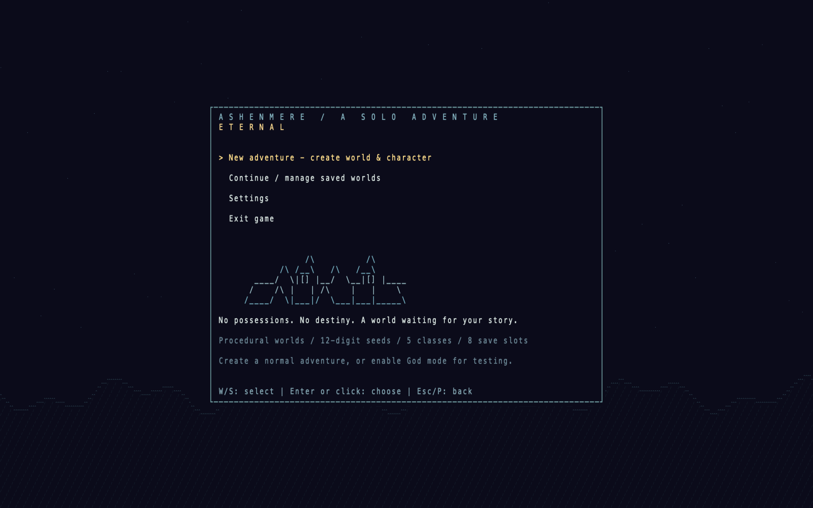
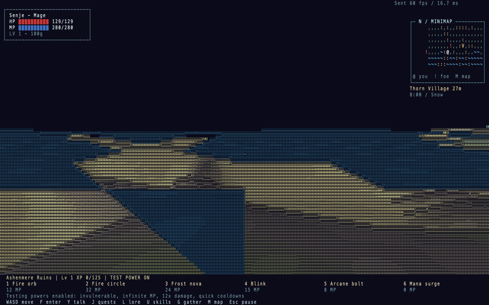

# Eternal

Eternal is a single-player ASCII RPG written in C++17, with a seeded procedural world and a native Metal window on macOS. Explore on foot in first person, fight enemies that learn simple combat tactics, collect equipment, develop your class, and discover towns, dungeons and the Dragon's hollow. It is a playable prototype under active development.



Build from the repository root with CMake 3.16+ and a C++17 compiler:

```sh
cmake -S . -B build -DCMAKE_BUILD_TYPE=Release
cmake --build build --parallel
./build/eternal_rpg --window  # macOS: native Metal ASCII window
./build/eternal_rpg           # terminal mode
```

On macOS, install Apple's Command Line Tools. All game host code, including the window and native tests, is C++17; a C++ runtime bridge calls AppKit and Metal. GPU shaders use Metal Shading Language. No Objective-C++ compiler or scripting runtime is needed to run the game. Terminal backends exist for macOS, Linux and Windows; local validation has been on macOS. For a Windows multi-configuration build, use `cmake --build build --config Release` and run `build\Release\eternal_rpg.exe`.

In VS Code, select **Eternal — GPU Window (recommended)** under **Run and Debug**, then use **Run → Run Without Debugging**. **Eternal: Run** also launches the native window on macOS; **Eternal — External Terminal** launches terminal mode. Configure CMake before using the build task. These launches build the whole project; a single-file Run Code button cannot build the game.

The checked-in macOS task points to `/private/tmp/eternalrpg-build-tools/cmake/data/bin/cmake`. Change that path in [.vscode/tasks.json](.vscode/tasks.json) to your installed CMake if needed. This workspace uses the compatible macOS 26.5 SDK via `-DCMAKE_OSX_SYSROOT=/Library/Developer/CommandLineTools/SDKs/MacOSX26.5.sdk`; other machines should use an SDK compatible with their installed compiler/linker.

Choose **New adventure** to enter world/player names, select Warrior, Mage, Archer, Cleric or Rogue, edit the generated **12-digit seed**, and choose whether to enable God mode. New characters start at level 1 with zero gold, an empty inventory and no equipment. God mode is off by default; enabling it grants invulnerability, unlimited mana, 12× ability damage and 0.12-second ability cooldowns. It can also be toggled in Settings.

| Control | Action |
| --- | --- |
| Enter / click | Choose a menu item; edit or finish a text field |
| Esc / P | Pause or resume; menus release captured mouse look |
| W/S or arrows in menus | Select an option |
| A/D or Left/Right in Settings | Change selected setting |
| WASD | Move relative to the camera in the 3D view |
| Hold Shift + WASD | Sprint at 1.8× speed in the native window |
| Space | Jump |
| Mouse movement | Look and aim with the center crosshair in first person |
| Right mouse drag | Orbit/tilt in third-person mode |
| Click / 1–6 | Primary ability / class abilities |
| Tab | Cycle nearby targets |
| I, then J/K and Enter | Inventory: select and equip/unequip |
| E / G | Collect nearby loot / gather materials |
| F / Y | Interact with a site or interior object / talk to a resident |
| J / L / U | Quest journal / learned history / mastery, talents and crafting |
| C, then 1–5 | Change class outside combat, or anytime in God mode |
| M | World atlas; WASD pan, +/- zoom, C center, Tab select, Enter travel |
| 1–5 on map | Travel to discovered starting landmarks |
| T on map | With God mode enabled, jump into procedural wilderness |
| + / - / scroll | View magnification; orbit distance in third person |
| [ / ] | Adjust 3D field of view |
| F8 / F9 | Native raw 3D preview / renderer diagnostics |
| B / R | Travel to Dragon arena / respawn after death |
| H / Q | Controls overlay / exit |

Native movement supports held diagonal combinations such as WA and WD, normalized to the same speed as straight movement. Jumping uses gravity and landing, and respects existing obstacle/cliff collision. Terminal movement depends on keyboard repeat; mouse or arrow keys aim in the 2D view. On macOS, footsteps, jumps, landings and successful casts have synthesized sounds; `--mute` disables them. Other platforms currently run silently.

Pause offers resume, settings, world map and save/exit options. Menus freeze combat and world time. Settings include God mode, optional companions, frame-rate target, world glyph density, zoom, names and control hints. Preferences are stored in `.eternalrpg-settings.txt`.

**Continue / manage saved worlds** supports eight slots, with continue and confirmed deletion. Adventures autosave every 30 seconds of play and on normal exit; **Save Now** is available from pause. Saves retain the seed, generation settings, character progression, equipment, discoveries, nearby enemies, boss progress, quests, interiors, economy, materials, bounties and learned enemy networks. Active projectiles and temporary combat effects reset on load. Save format 7 reads versions 1–6; older adventures start with fresh combat networks. Back up `saves/` to transfer worlds, and keep matching game data/mod versions. The executable and save/settings paths retain their historical `eternal_rpg` / `eternalrpg` names for compatibility.

The world uses seeded multi-octave noise and domain warping for elevation, with climate-based blending between grassland, deep forest, frost forest, swamp, desert, rocky highlands, snowy mountains and coast. Slopes affect movement and steep cliffs block it. Terrain streams in 64×64 chunks with a bounded 7×7 cache. The same seed, build and mod set regenerate the same terrain. Coordinates support roughly ±1,000,000 world units per axis; the world is large but finite. Building, mining and persistent terrain editing are not implemented.

Lakes use horizontal water surfaces clipped against their terrain beds, including a carved starting basin. Rivers, reflective water and full water physics are unfinished. The minimap shows nearby surroundings, while the atlas tracks exploration and discovered sites. Ashenmere, Frostwood, Ember Hills, Reedlands and Dragon Hollow remain starting landmarks; towns and other sites extend into the frontier.

Encounters stream around the player, with at most 100 active mobs. Defeated enemies respawn after a configurable interval, and distant surviving enemies reset when regenerated. Enemy levels scale with distance and stop at **80**, independently of the player's level. Older over-cap saved mobs have their level-scaled health/power reduced on load. Player level-ups cost `100 + 25 × current level` XP and grant +8 maximum HP and +2 power. Newly discovered starting landmarks award 150 XP.

Hostile mobs use a **7-input, 12-hidden-neuron, 5-output C++ neural network** to choose approach, strike, circle left/right or retreat. Each enemy type shares experience within a save. Decisions normally occur every 0.3 seconds, learning from actual damage dealt/received and closing distance, with occasional exploration. This is short-term action learning, not strategic planning; improvement is not guaranteed in every encounter. Range, cooldowns, collision and level limits still apply. Training against God mode is skipped. Weights and exploration state persist in saves; friendly companions and the Dragon keep their scripted AI.

Equipment has Weapon, Clothing and Charm slots and modifies power/armor. Shops, gathering, crafting, class mastery/talents, witnessed theft and town bounties are playable. Resident jobs cycle through dungeon recovery, delivery and escort travel. See [living-world controls](docs/LIVING_WORLD.md) for objectives and interactions. Richer item generation and autonomous social relationships remain unfinished.



The native outdoor renderer draws perspective terrain into offscreen color, depth and normal buffers, then converts it to colored ASCII on the GPU. Depth/normal edges guide glyph selection, and hills occlude creature sprites and their labels. Characters and many objects still use projected glyph sprites rather than fully modeled 3D geometry. HUD and menus use a separate crisp text grid. Soft shadows, full 3D vegetation, reflective water and volumetric effects are unfinished; see the [renderer development log](docs/RENDERER_3D.md).

First person is the native default. Use `--third-person` for an orbit camera, `--raw-3d` for terrain preview, or `--renderer-2d` for the previous native renderer. Settings offer Comfort, Detailed and Dense world grids independently of HUD text size. At a 1280×800 window, Detailed uses about 320×100 world cells and 160×50 HUD cells. Terminal mode uses the 2D renderer and benefits from a truecolor terminal, monospace font and roughly 200×60 cells. Interiors retain their existing renderer.

Mods are declarative data packs loaded from `mods/`. Enable a folder name in [mods/enabled.txt](mods/enabled.txt) or select one at launch:

```sh
./build/eternal_rpg --window --mod wild_frontier
./build/eternal_rpg --list-mods
./build/eternal_rpg --window --no-mods
```

The disabled-by-default Wild Frontier example changes vegetation, lakes and enemy density and adds a Frontier Stalker. Packs can override generation settings and content tables; new algorithms or ability behaviors require C++ changes. See the [mod guide](docs/MODS.md).

For testing and diagnostics:

```sh
ctest --test-dir build --output-on-failure
./build/eternal_rpg --window --scene boss --demo
./build/eternal_rpg --window --demo --normal --seed 42 --scene water
./build/eternal_rpg --benchmark --scene boss --demo --frames 600 --stats metrics.json
./build/eternal_native_input_tests --renderer-only  # macOS graphical desktop
./build/eternal_native_input_tests --audio-only     # macOS audio output
```

`--demo` and headless runs skip the title and saved preferences; testing powers are enabled unless `--normal` is supplied. `--seed`, `--name`, `--class`, `--fps`, `--scene`, `--position` and `--data` provide startup overrides; run `--help` for options. An explicit class/FPS overrides remembered preferences. `ER_CAPTURE=/tmp/eternal.png ./build/eternal_rpg --window --demo --frames 2` captures a GPU frame. Optional Python terminal checks and capture utilities are developer tools, not game dependencies.

The latest combat-learning change passed **291 core checks**. A local Release stress test with 100 engaged stationary mobs measured the complete mob-AI update at **0.030 ms mean / 0.044 ms p95**. This measures CPU AI work, not display FPS. F9 reports renderer timings; displayed `Sent fps` measures submissions rather than verified display scanout. Full native input automation requires reliable desktop keyboard focus and has not passed consistently in this environment. See [validation notes](docs/VALIDATION.md), [historical milestones](docs/MILESTONES.md) and [PROGRESS.md](PROGRESS.md) for test history and outstanding work.
