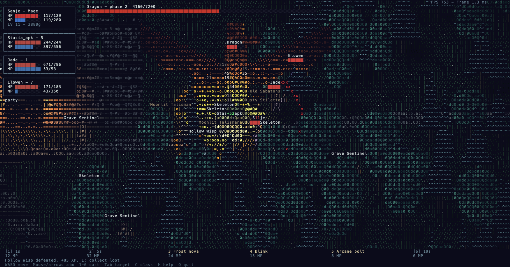
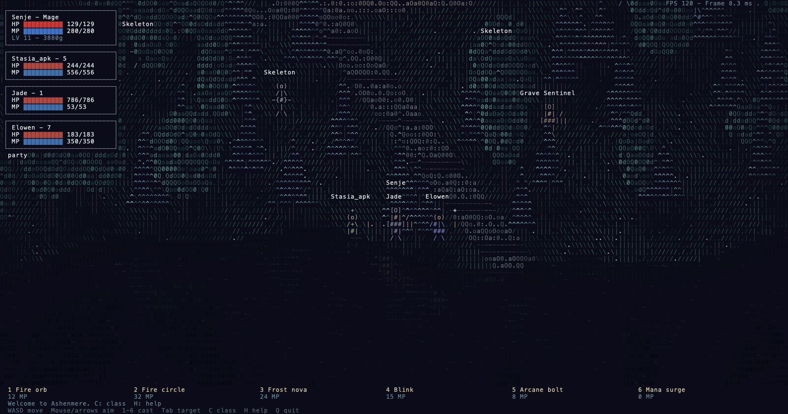
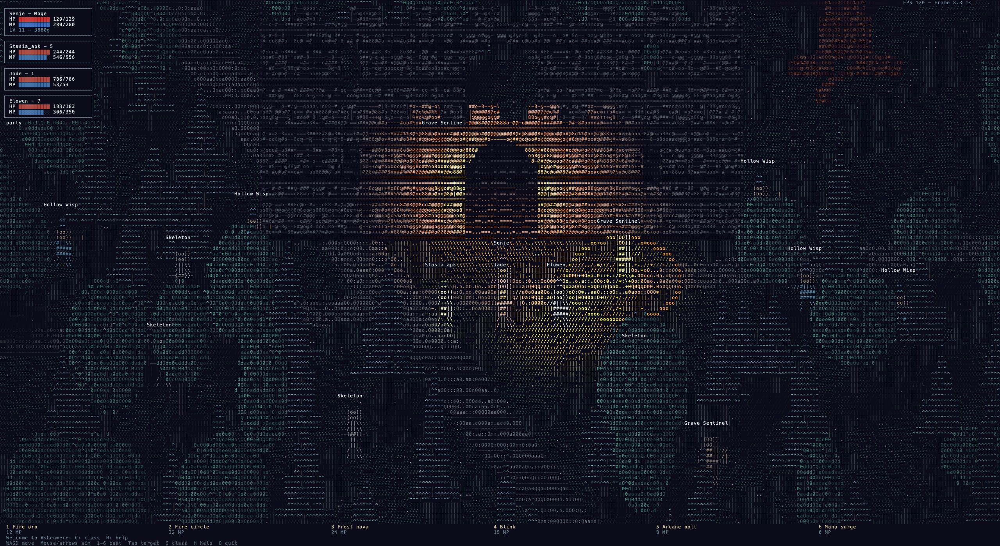

# EternalRPG

A playable C++17 terminal RPG with a procedural ASCII world, five classes, AI companions, a three-phase Dragon encounter and optional cooperative TCP multiplayer. Built in ten compiling milestones from the five supplied reference recordings.



Build with CMake 3.16+ and a C++17 compiler. No ncurses, game engine, package manager or runtime graphics library is required.

For VS Code's C/C++ extension, configure CMake first: the included editor configuration reads `build/compile_commands.json` for the compiler's actual C++17 settings. Build the CMake project rather than compiling `game.cpp` alone, since it depends on the other game modules.

On this Mac, open VS Code's **Run and Debug** sidebar, select **EternalRPG — External Terminal**, and click the green play button. It builds the whole project and opens the game in macOS Terminal. **Run → Run Without Debugging** uses the same configuration. The separate Code Runner **Run Code** button runs individual files and does not use this launch configuration. The build task currently points to the CMake installation in `/private/tmp/eternalrpg-build-tools`; update its macOS command if that temporary installation is removed.

```sh
cmake -B build
cmake --build build
./build/eternal_rpg
```

On Windows, use a Developer PowerShell with Visual Studio's C++ tools, build with `cmake --build build --config Release`, then run `.\build\Release\eternal_rpg.exe` in a VT/truecolor terminal. POSIX terminal and socket backends cover Linux and macOS; Windows uses console APIs and Winsock. Local validation was on macOS ARM64. CI is configured for all three platforms; Linux/Windows results have not been run in this workspace.

Use a dark truecolor terminal, a monospace font and about **200 columns × 60 rows**. A small font and more rows provide finer geometry; the camera scales with terminal height. For finer detail, maximize the external terminal and use **Command-minus** to shrink the font; aim for **320×100** cells (Menlo around 8–9 pt). The renderer automatically uses the extra rows and columns. Increasing `--width` does not resize an interactive terminal; that option is for headless captures. Compact HUD mode activates below 80 columns or 28 rows. Below 40×16, the game asks for more space. Presentation targets 60 FPS by default; `--fps 30` reduces terminal output further. Use `--fps 120` only if your terminal keeps up. Simulation remains 60 Hz.

| Control | Action |
| --- | --- |
| W A S D | Move; hold for keyboard repeat |
| Mouse / arrow keys | Aim the white crosshair |
| Left click / Space | Primary ability |
| 1–6 | Cast hotbar ability |
| Tab | Cycle nearby enemies/allies, including fallen allies |
| C, then 1–5 | Choose Warrior, Mage, Archer, Cleric or Rogue outside combat |
| E | Collect loot within four world units |
| I | Inventory and equipment |
| J / K, Enter | Select/equip an inventory item |
| R | Respawn when dead, costing 25 gold |
| B | Travel to the Dragon arena |
| + / - / mouse wheel | Zoom |
| H | Controls overlay |
| Q / Ctrl-C | Exit and restore the terminal |
| Enter (online) | Chat; `/who`, `/invite ID`, `/accept`; Ctrl-G cancels typing |

Standard terminal input has no portable key-release event. Movement uses a short renewal window and the terminal's keyboard repeat. Arrow keys adjust aim, so WASD handles movement.

The VS Code launch configuration uses a 30-FPS presentation target for the dense external-terminal view. Input polling and simulation continue at 60 Hz between presentations. On Apple Terminal, a cursor-position acknowledgement gates the next frame to limit output backlog; terminals that do not reply within 250 ms fall back to ordinary paced output. The HUD's **Sent fps** measures submissions, not the terminal emulator's visible refresh rate. Acknowledgements indicate that escape sequences were processed, not that pixels were painted. Smaller fonts add detail but also increase the amount of terminal drawing work.

Try the reference scenes:

```sh
./build/eternal_rpg --scene water
./build/eternal_rpg --scene forest
./build/eternal_rpg --scene ruins
./build/eternal_rpg --scene boss --class Cleric
./build/eternal_rpg --scene boss --demo
```

`--demo` uses the same abilities and resource rules, aims at enemies and dodges ground hazards. Normal play starts as Senje, a Mage, with Stasia_apk (healer), Jade (tank) and Elowen (mage). Defeat enemies for XP, loot and gold; equip weapons, boots and charms. The Dragon has red 1.5-second telegraphs, fire breath, persistent fire, wing sweeps, summoned skeletons and an enrage timer. A wipe resets the encounter; victory awards gold, Dragonfang and Emberguard Boots.



For multiplayer, open separate terminals:

```sh
./build/game_server --port 7777
./build/eternal_rpg --connect 127.0.0.1:7777 --name Senje
./build/eternal_rpg --connect 127.0.0.1:7777 --name Elowen --class Cleric
```

The server controls movement, combat, loot and progression, sending snapshots at 20 Hz. Clients interpolate positions with 100 ms of delay. Eight players can share a session; chat invitations establish party membership. The default listener is loopback. See [network setup and protocol](docs/NETWORK.md) for LAN hosting.

The world, inventory and server are session-based. There is no save file, persistent realm, account system, matchmaking or Internet hosting service. This is a playable cooperative prototype, with simplified character/dragon geometry. The source videos have far more glyphs per object; 200×60 cannot reproduce that detail or optical bloom exactly. All world objects use colored foreground glyphs on the same navy background. Spell glow is light applied to those glyphs.



Validation and captures:

```sh
ctest --test-dir build --output-on-failure
./build/eternal_rpg --benchmark --scene boss --demo --frames 1800 --stats metrics.json
./build/eternal_rpg --headless --scene water --frames 120 --dump water.frame.json
python3 tools/network_smoke.py build
python3 tools/terminal_smoke.py build/eternal_rpg  # POSIX only
```

Headless mode advances one fixed simulation step per frame, without pacing. It defaults to 600 frames. Its FPS measures CPU/ANSI-encoding throughput, not a terminal emulator's drawing speed. `--stats` records wall-clock FPS, mean/p95 work time and output bytes. `--dump` exports every real framebuffer cell as JSON. `tools/media.m` is optional macOS tooling for extracting reference frames, rendering captures with Menlo and making side-by-side comparison sheets; it is not used by the game.

Tests cover math/projection, ASCII/lighting, input framing, combat costs and effects, progression, equipment, boss phases/wipes/rewards, deterministic replay and snapshot parsing. The network integration test additionally launches real clients. Python is optional and used only for the integration scripts. See [validation results](docs/VALIDATION.md) and the [milestone comparison log](docs/MILESTONES.md).

Data lives in `data/*.txt`: classes, all 30 abilities, enemies, items, boss stats and phases. Comments describe each format. Use `--seed N`, `--name NAME` or `--data DIR` to customize a session. Data is loaded from `./data` when present, with the source data path as a fallback. Run `--help` for all options.

Source modules: `platform/` terminal/input, `renderer/` cell and depth buffers, `ascii_conversion/` light/material conversion, `world/` terrain/grass/reflections, `entities/`, `combat/`, `ai/`, `ui/`, `net/` and `assets/`. Simulation never reads wall-clock time; the main loop accumulates elapsed time and executes fixed ticks separately from rendering.

If macOS reports an SDK/toolchain mismatch, select a compatible installed SDK when configuring. This workspace used `-DCMAKE_OSX_SYSROOT=/Library/Developer/CommandLineTools/SDKs/MacOSX26.5.sdk` because its default SDK was newer than its compiler. The project does not require that specific SDK on other machines.
