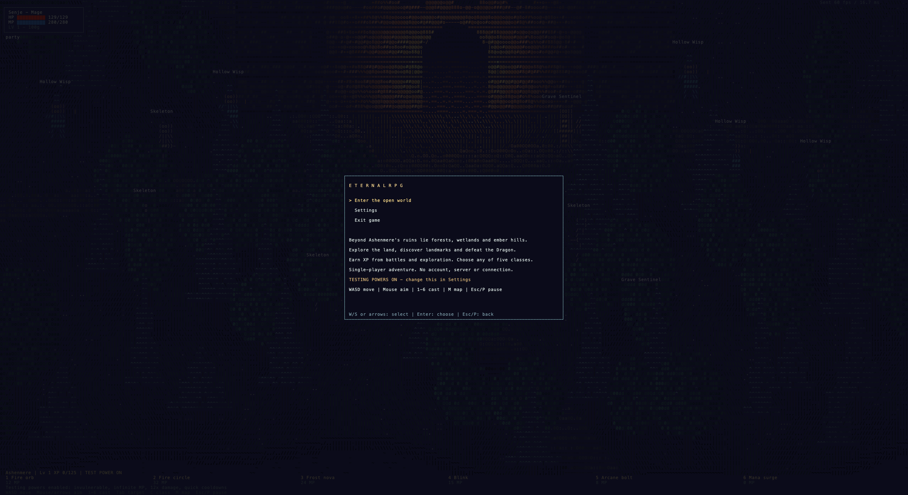

# EternalRPG

A single-player ASCII RPG in C++17 with a seed-based, streamed procedural world. Explore Ashenmere, Frostwood, Ember Hills, Reedlands and Dragon Hollow; defeat enemies, discover landmarks, earn XP and fight the Dragon. The networking client, server and multiplayer source have been removed.



On this Mac, select **EternalRPG — GPU Window (recommended)** in VS Code's **Run and Debug** dropdown and click **▶**. Press **Enter** on the introduction screen to start. The original external-terminal launch remains available.

```sh
cmake -B build
cmake --build build
./build/eternal_rpg --window  # native Metal window, macOS
./build/eternal_rpg           # terminal mode
```

The game, world, menus, settings and progression are C++. The macOS window uses a small Objective-C++ bridge to Apple's AppKit/Metal APIs; it has no Python, JavaScript or game-engine runtime. Terminal backends are provided for macOS, Linux and Windows. Only macOS has been tested locally; CI is configured for all three. On Windows, use `cmake --build build --config Release` and run `build\Release\eternal_rpg.exe`.

Testing powers are **on by default** for easy exploration: invulnerability, unlimited mana, 12× ability damage and 0.12-second ability cooldowns. Turn them off in Settings for normal combat, or launch with `--normal`. The title shows which mode is active. Normal play starts at level 1. Testing mode doesn't replace your class or level and can be toggled during a session.

| Control | Action |
| --- | --- |
| Enter | Start the adventure / choose a menu item |
| Esc / P | Pause, resume, or return from settings |
| W/S or arrows in menus | Select an option |
| A/D or Left/Right in Settings | Change selected setting |
| WASD | Move |
| Mouse / arrow keys in game | Aim |
| Click / Space | Primary ability |
| 1–6 | Cast abilities |
| Tab | Cycle targets |
| M | World map |
| T on map | With testing powers enabled, jump to new procedural wilderness |
| 1–5 on map | Travel to discovered landmarks; testing mode unlocks all destinations |
| I, then J/K and Enter | Open inventory, select and equip |
| E | Collect nearby loot |
| C, then 1–5 | Change class outside combat (anytime with testing powers) |
| + / - / scroll | Camera zoom |
| B | Travel to Dragon arena |
| R | Respawn after death |
| H | Controls overlay |
| Q | Exit |

Pause offers **Resume, Settings, World Map, Return to Title, and Exit**. Menus freeze combat, AI, cooldowns and world time. Returning to title keeps the current session.

Settings include testing powers, optional AI companions (off by default), frame-rate target, native-window detail, camera zoom, name labels, control hints and class. Settings are saved on a normal exit to `.eternalrpg-settings.txt` in the working directory. Character/world progress is currently **session-only**: exiting starts a fresh adventure next time. Class selection is unavailable during normal combat. Native detail changes glyph resolution; terminal mode takes its grid size from the terminal window.

The world is generated from **seed + coordinates**, using smooth value noise for biomes/lakes and coordinate hashes for trees and enemies. The old 500×500 boundary is gone. Terrain streams in 64×64 chunks; only a 7×7 neighborhood is cached, so exploration does not keep expanding memory usage. Unloaded terrain regenerates identically for the same seed and mod set. The five starting landmarks and ruins remain near the origin; the frontier continues beyond them with forests, grassland, ember hills, wetlands, lakes and roads.

Enemy spawns are generated around the current chunk. Distant encounters unload, new regions create new encounters, and defeated enemies respawn after a configurable interval. At most 100 mobs are active at once. Kill cooldowns survive leaving and returning during the cooldown, but distant surviving enemies reset when regenerated. Dropped loot beyond 200 units is discarded. This provides continuing encounters rather than a finite initial enemy population.

This is an effectively large procedural world, not mathematical infinity: the current float-coordinate implementation supports ±1,000,000 world units per axis. There is no voxel building/mining system. Persistent world edits and cross-session saves are not implemented. **M → T** jumps farther into the generated frontier in testing mode; **M → 1** returns home. The map now follows your position instead of displaying the entire world.

Landmarks award 150 discovery XP once per session. Enemies grow stronger with distance (enemy level caps at 100) and award level-scaled XP. Each player level costs `100 + 25 × current level` XP and grants **+8 maximum HP and +2 power**. These bonuses survive class changes.

Mods are loaded from `mods/`. Add a folder name to [`mods/enabled.txt`](mods/enabled.txt) and restart, or run:

```sh
./build/eternal_rpg --window --mod wild_frontier
./build/eternal_rpg --list-mods
./build/eternal_rpg --window --no-mods
./build/eternal_rpg --window --mod wild_frontier --position 4096 -4096
```

The included **Wild Frontier** example is disabled by default. It changes forest/lake generation and enemy density, and adds a Frontier Stalker. Mods can override generation parameters and the existing content tables. These are declarative data packs, not arbitrary executable plugins or scripts. See the [mod creation guide](docs/MODS.md) for the format, load order, supported fields and limits.

The Metal backend renders the same RGB glyph framebuffer using a cached Menlo atlas and one GPU draw call. It avoids ANSI terminal output and handles held movement keys and key releases directly. Use **Comfort**, **Detailed**, or **Dense** in Settings to balance readable text against glyph density. The displayed `Sent fps` measures submissions, not verified display scanout.

Terminal mode needs a truecolor terminal and a monospace font. About 200×60 cells is a useful starting point. More rows/columns improve detail but increase terminal work; 320×100 is better suited to the GPU window. Terminal movement depends on keyboard repeat because portable terminals do not report key releases.

```sh
./build/eternal_rpg --window --scene boss --demo
./build/eternal_rpg --normal --scene forest
./build/eternal_rpg --benchmark --scene boss --demo --frames 600 --width 320 --height 100
ctest --test-dir build --output-on-failure
python3 tools/terminal_smoke.py build/eternal_rpg  # optional POSIX developer check
```

`--demo` and headless runs skip the introduction and saved preferences for reproducibility. Use `--seed`, `--name`, `--class`, `--fps`, `--scene` and `--data` for startup overrides. An explicit class/FPS overrides the remembered setting. Data tables in `data/` define five classes, 30 abilities, enemies, items and boss phases. Run `--help` for options. Python and the optional macOS capture tool are development utilities, not game dependencies.

See [validation](docs/VALIDATION.md) and the [historical milestones](docs/MILESTONES.md). Original reference screenshots in that log predate the solo conversion. The visuals still approximate the reference videos; this remains a playable prototype rather than a finished commercial RPG.

This workspace uses a compatible macOS 26.5 SDK (`-DCMAKE_OSX_SYSROOT=/Library/Developer/CommandLineTools/SDKs/MacOSX26.5.sdk`). The VS Code build task currently points at `/private/tmp/eternalrpg-build-tools/cmake/data/bin/cmake`; update its command if that temporary installation is removed. CMake exports a compilation database used by the included VS Code C/C++ configuration. Use the whole-project launch, not Code Runner's single-file Run Code button.
